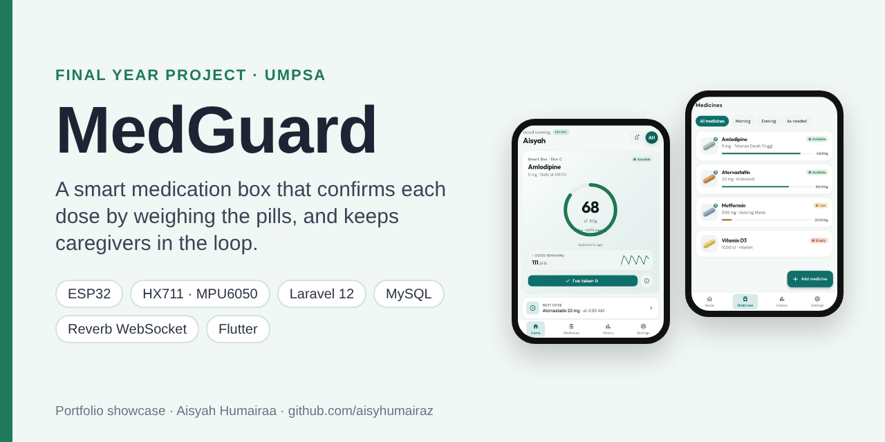
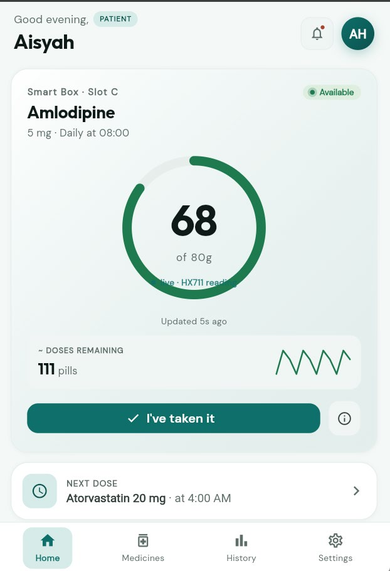
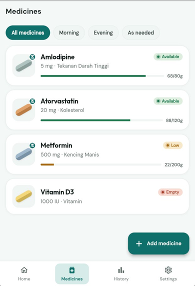
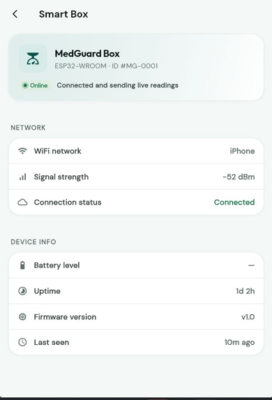
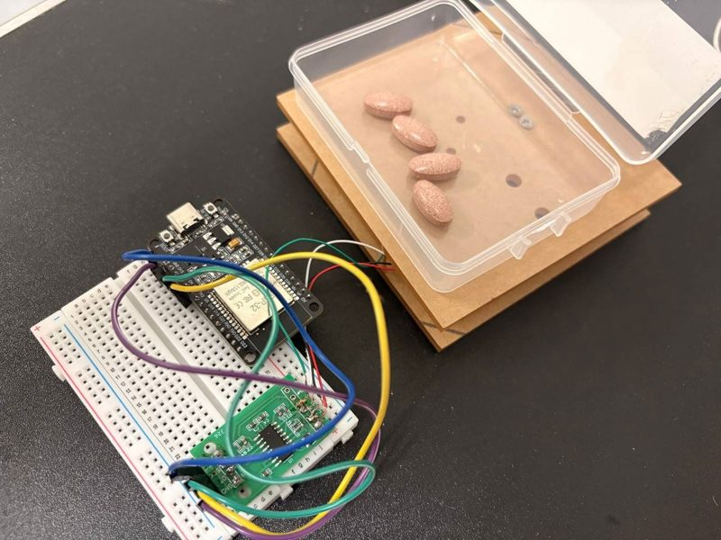
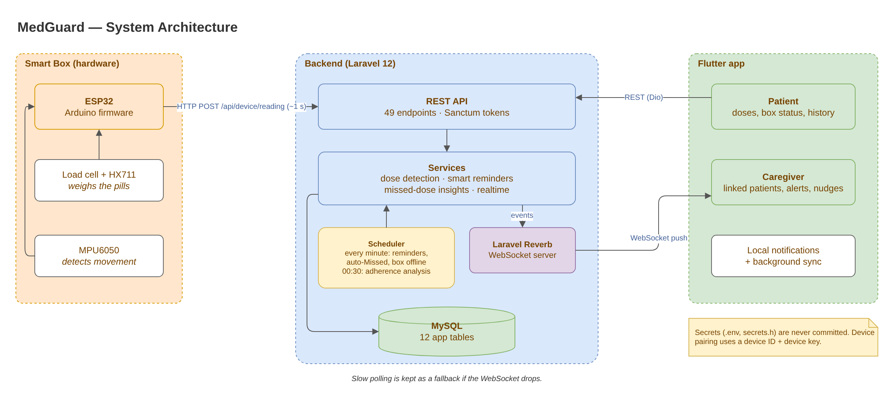
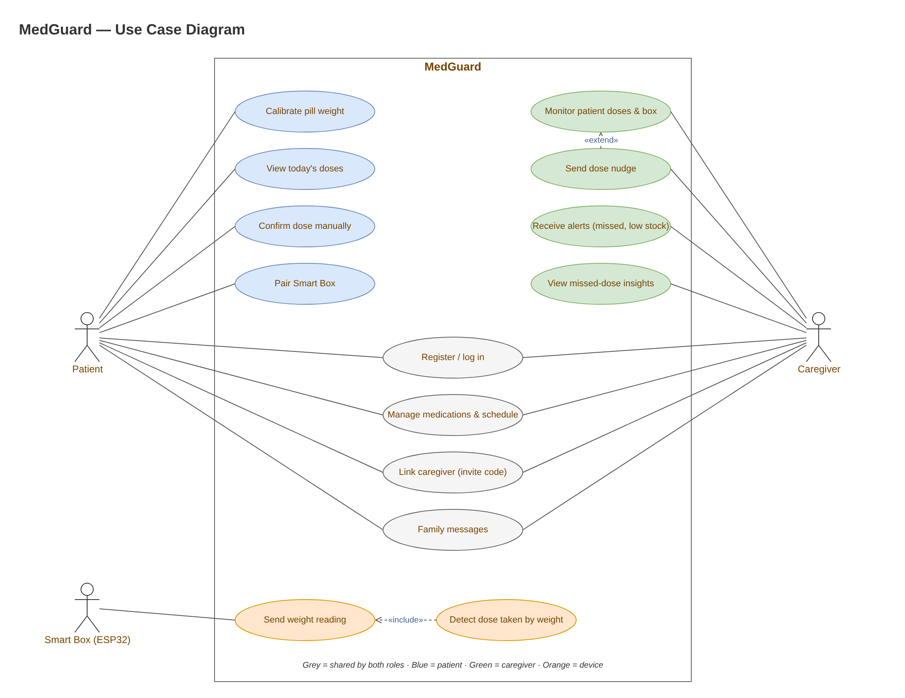
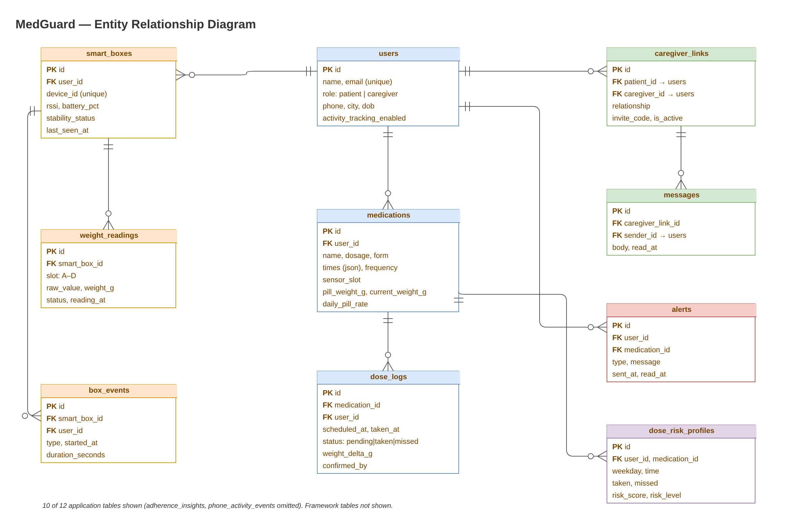
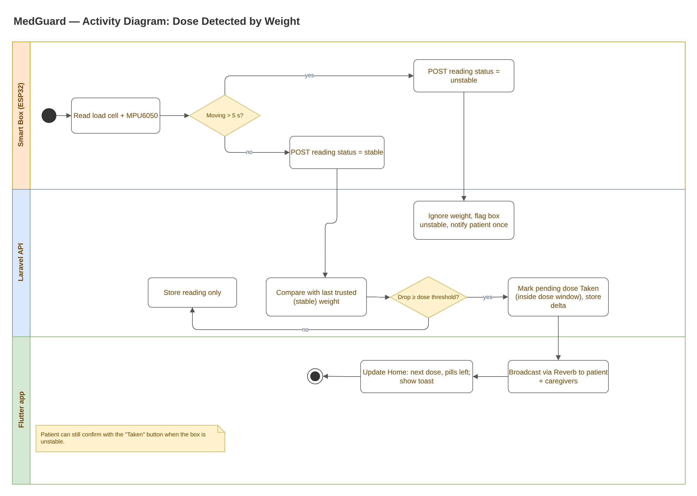

# MedGuard — Smart Medication Box

> **Portfolio showcase.** Source code is private; a live walkthrough or code review is available on request.

**Type:** Final Year Project, Universiti Malaysia Pahang Al-Sultan Abdullah (UMPSA)  
**Role:** Solo developer — hardware, firmware, backend, mobile app and testing  
**Period:** 2026 – present (ongoing)  
**Status:** Working prototype (ESP32 smart box + Laravel API + Flutter app)

## The problem

Many patients, especially older adults, forget doses or are not sure whether they already took them. Reminder apps only know that a notification was sent, not whether the pill actually left the box. Family members who help with medication usually have no way to check from afar.

## The idea

MedGuard puts the pill container on a **load cell**. When the weight drops by at least one dose during the dose window, the backend marks that dose as **Taken** and tells the patient and their linked caregivers in real time. A motion sensor stops false readings when the box is picked up or carried around.

## Key features

| Feature | What it does |
|---|---|
| Dose detection by weight | ESP32 + HX711 load cell; a pending dose becomes *Taken* only when the weight drop reaches the dose threshold inside its time window |
| Movement guard | MPU6050 marks the box *unstable* after 5 s of movement; weight is ignored and the patient is asked to put the box on a flat surface |
| Pill calibration | Per-medicine empty and per-pill weight, so the app can show **pills left** and warn on low stock |
| Smart reminders & auto-Missed | Scheduler runs every minute: reminders, marking overdue doses as *Missed*, and flagging boxes that went offline |
| Caregiver linking | Invite code, relationship, linked-patient dashboard, dose nudges and missed-dose alerts |
| Missed-dose insights | Nightly rule-based analysis scores which weekday/time slots a patient tends to miss |
| Family messages | Simple chat between a patient and each linked caregiver |
| Live updates | Laravel Reverb WebSocket pushes changes to the app, with slow polling as a fallback |

## Screenshots

  
  
  

*App screens from the PSM1 prototype (July 2026), with demo data. Hardware: ESP32 + HX711 + load cell under the pill container.*

## System design

**System architecture**  

**Use case diagram**  

**Entity relationship diagram**  

**Activity diagram — dose detected by weight**  

*Editable `.drawio` files are in [`docs/diagrams`](docs/diagrams) (open with [app.diagrams.net](https://app.diagrams.net)).*

## Engineering highlights

- **Trust only stable weight.** Each reading carries a `stable` / `unstable` status from the MPU6050. The backend compares new readings only with the last *stable* reading, and the first stable reading after a movement period becomes the new baseline. This stops a lifted or shaken box from creating fake doses.
- **Dose windows, not just weight drops.** A weight drop marks a dose as taken only when there is a pending dose inside its window. Pills removed again soon after a dose trigger a possible double-dose notice instead of a second *Taken*.
- **Device authentication.** The box sends a device ID and device key; only a box paired to an account can post readings. User requests use Laravel Sanctum tokens.
- **Real-time with a fallback.** Laravel Reverb broadcasts dose and alert events on per-user channels. The app keeps slow polling for when the WebSocket drops, so the UI never goes stale.
- **Background jobs on a schedule.** Reminders, auto-Missed and offline checks run every minute; adherence analysis runs nightly at 00:30.
- **Tested backend.** 99 PHPUnit tests across 11 test files cover dose accuracy, device stability, calibration, security, realtime events, insights and messaging.
- **Secrets stay out of git.** `.env` and the firmware `secrets.h` are ignored; templates are provided instead.

**By the numbers (counted from the code):** 49 API routes · 12 application tables (22 migrations) · 12 Eloquent models · 4 service classes · 23 Flutter screens in 12 feature modules.

## Tech stack

| Layer | Technology |
|---|---|
| Hardware | ESP32 (ESP32-WROOM), load cell + HX711, MPU6050 accelerometer/gyro |
| Firmware | Arduino C++ (HX711, WiFi, HTTPClient, ArduinoJson, Preferences) |
| Backend | Laravel 12 (PHP 8.2), Laravel Sanctum, Laravel Reverb, Laravel Scheduler |
| Database | MySQL |
| Mobile app | Flutter, Riverpod, go_router, Dio, flutter_local_notifications, workmanager, web_socket_channel |
| Testing | PHPUnit feature tests |
| Method | Rapid Application Development (RAD) |

## How I used AI tools while building this

I used an AI coding assistant (Claude Code) as a **pair-programmer**: for boilerplate, refactoring suggestions, debugging help and drafting tests. The requirements, system design, database design, hardware setup and the final decisions are my own work. I reviewed and tested every change on the real device before keeping it.

MedGuard itself has no generative-AI feature; the "missed-dose insights" are rule-based statistics computed from dose history.

## Contact

**Aisyah Humairaa binti Abdul Aziz** — Software Engineering student, UMPSA  
Email: aisyahhumairaa287@gmail.com  
LinkedIn: [linkedin.com/in/aisyah-humairaa-9888581a6](https://www.linkedin.com/in/aisyah-humairaa-9888581a6)

© 2026 Aisyah Humairaa binti Abdul Aziz. Shared for portfolio viewing only; all rights reserved.
